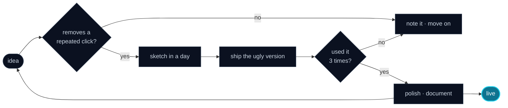

<!--
  ╭──────────────────────────────────────────────────────────────────────╮
  │  README.md — interactive edition                                     │
  │  github.com/Harshil26r/Harshil26r                                    │
  │                                                                      │
  │  No generators, no templates. Hand-written markdown + SVG widgets.   │
  │  Click things: every <details> below is a doorway.                   │
  ╰──────────────────────────────────────────────────────────────────────╯
-->

<div align="center">


<a href="https://git.io/typing-svg">
  
</a>

<br/>

<a href="#01-whoami"></a>
<a href="#02-the-work"></a>
<a href="#03-the-stack"></a>
<a href="#04-the-proof"></a>
<a href="#05-how-i-ship"></a>
<a href="#06-ask-me"></a>
<a href="#07-signal"></a>

<br/><br/>

<em>in a hurry? → <a href="#02-the-work">see the work</a> · here to judge the code? → <a href="#03-the-stack">the stack</a> · just curious? → <a href="#06-ask-me">ask me anything</a></em>

</div>

---

## 01 whoami

I build **AI agents** and the **automation** around them. Most of my daylight goes to the web — React, TypeScript, Node — and most of my night goes to Rust, Linux tooling, and deleting one more repetitive click from my day.

If a task can be done twice, it should probably be a script by the third time.

```text
harshil@surat
──────────────────────────────────────────────────────────────────
  now        building agents that handle the boring parts
  stack      TypeScript · Python · React · Rust
  os         Omarchy / Arch · zsh · tmux
  editor     VS Code + Neovim (whichever opens first)
  shipped    story-builder · cloud-storage · page_builder
  learning   Rust, systems programming, agent architecture
  fuel       ████████████████░░░░  always one refill short
  motto      "automate it, then automate the automating"
──────────────────────────────────────────────────────────────────
  9 public repos · Surat, Gujarat, IN · open to collabs
```

<div align="center">

[](https://harshil26r.vercel.app/)
[](https://github.com/Harshil26r)
[](https://github.com/Harshil26r/Harshil26r/issues/new)

</div>

---

## 02 the work

<sub>click a project to unfold it</sub>

<details>
<summary><b>story-builder</b> — a story that argues back &nbsp;<code>React 19 · TypeScript · MongoDB</code></summary>

<br/>

A branching narrative builder: write one scene, watch the story fork. The part I'm proudest of isn't the UI — it's the process around it. A multi-agent workflow (specifier → ticketer → builder → reviewer) turns an idea into specs, tickets, and reviewed code before I touch the keyboard.

**Why it exists:** I wanted to know whether agents can hold a real codebase together. Verdict so far: mostly, with supervision.

`React 19` `Vite` `Express` `MongoDB` `agent workflow`

[→ read the code](https://github.com/Harshil26r/story-builder)

</details>

<details>
<summary><b>cloud-storage</b> — one app, five backends &nbsp;<code>JavaScript · Node · MongoDB</code></summary>

<br/>

A file-storage service rebuilt several ways on purpose: plain Node, Express, MVC, MongoDB-backed, auth-first. Same product, different architectures — the fastest way I've found to learn what each layer actually buys you.

**Why it exists:** tutorials teach you one way. Rebuilding teaches you the trade-offs.

[→ read the code](https://github.com/Harshil26r/cloud-storage)

</details>

<details>
<summary><b>page_builder</b> — pages and posts without a deploy &nbsp;<code>Next.js · Tailwind</code></summary>

<br/>

A content builder with dynamic slugs, a blog API, and OTP-based signup and login. Write, publish, duplicate, schedule — all from the browser.

[→ read the code](https://github.com/Harshil26r/page_builder)

</details>

<details>
<summary><b>omarchy-config</b> — the desktop, under version control &nbsp;<code>Lua · Shell</code></summary>

<br/>

My Omarchy setup, committed: Hyprland, Waybar, Alacritty, Ghostty, Neovim. Reinstall the OS, clone this, and the machine feels like mine again in ten minutes.

[→ read the code](https://github.com/Harshil26r/omarchy-config)

</details>

<details>
<summary><b>portfolio</b> — the site this profile points at &nbsp;<code>React · TypeScript · Vite</code></summary>

<br/>

[harshil26r.vercel.app](https://harshil26r.vercel.app/) — dark mode, carousels, no page builders. The source stays private; the result doesn't.

[→ visit the site](https://harshil26r.vercel.app/)

</details>

---

## 03 the stack

<details>
<summary><b>languages</b> — the ones I actually reach for</summary>

<br/>


<sub>in progress → Rust &amp; systems programming</sub>

</details>

<details>
<summary><b>web</b> — where most of the pixels happen</summary>

<br/>


</details>

<details>
<summary><b>ai</b> — the part that keeps me up at night</summary>

<br/>


<sub>spec → ticket → build → review, with a human in the loop</sub>

</details>

<details>
<summary><b>infra</b> — the boring stuff that has to work</summary>

<br/>


</details>

---

## 04 the proof

<div align="center">


<br/>


</div>

---

## 05 how i ship



<sub>Translation: I'd rather have a rough tool in use than a beautiful one in a folder.</sub>

---

## 06 ask me

<details>
<summary><b>What are you working on right now?</b></summary>

<br/>

Agent tooling and automation — the part where an AI stops chatting and starts finishing the task. Also slowly losing a fight with Rust's borrow checker.

</details>

<details>
<summary><b>Are you open to collaborating?</b></summary>

<br/>

Yes — especially anything involving agents, developer tools, or Linux. Open an issue on any repo, or [start a conversation here](https://github.com/Harshil26r/Harshil26r/issues/new). A specific idea beats a "let's connect".

</details>

<details>
<summary><b>What's the setup?</b></summary>

<br/>

Omarchy on Arch, zsh, tmux, and a split personality between VS Code and Neovim. Terminal-first, mouse when tired.

</details>

<details>
<summary><b>How is this README built?</b></summary>

<br/>

Markdown, a few SVG services, and no template. Everything here is in [this one file](https://github.com/Harshil26r/Harshil26r/blob/main/README.md) — fork the idea, not the file.

</details>

<details>
<summary><b>🥚 you clicked this one</b></summary>

<br/>

Congratulations, you found the hidden panel. Here's your reward:

```text
There once was a dev from Surat
who automated the whole of his flat.
  The kettle boiled twice,
  the code ran precise,
and the README did all of the chat.
```

Press <kbd>↑</kbd> <kbd>↑</kbd> <kbd>↓</kbd> <kbd>↓</kbd> <kbd>←</kbd> <kbd>→</kbd> <kbd>←</kbd> <kbd>→</kbd> <kbd>B</kbd> <kbd>A</kbd> … and nothing happens. GitHub sanitizes scripts. That's the joke.

</details>

---

## 07 signal

<div align="center">

<em>building something that needs an agent, a pipeline, or a Linux problem solver?</em>

[](https://github.com/Harshil26r/Harshil26r/issues/new)
[](https://harshil26r.vercel.app/)

<br/><br/>


</div>


